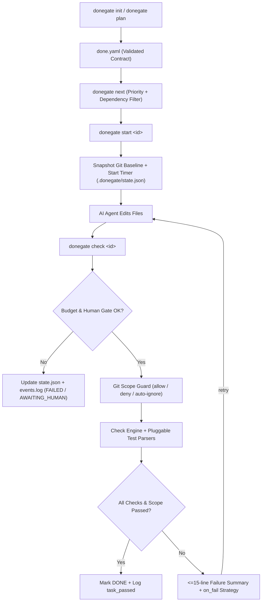

# DoneGate Architecture & How It Works

DoneGate is an executable contract and verification layer ("CI for AI agents") that sits between an AI coding agent and a Git repository. It ensures an agent cannot mark a task done until objective checks pass, cannot modify files outside its declared task scope, and cannot loop beyond its resource budget.

---

## 1. End-to-End Execution Flow

---

## 2. Core Components & Modules

### 2.1 Contract Specification (`src/donegate/contract/`)
- **`models.py`**: Defines Pydantic v2 models (`Contract`, `TaskSpec`, `ScopeSpec`, `BudgetSpec`, `CheckSpec`, `OnFailSpec`, `UsageCounters`).
  - Validates unique task IDs and known `depends_on` references.
  - Detects dependency cycles via 3-color DFS and prints the exact cycle path (`a -> b -> c -> a`).
  - Rejects tasks without at least one objective check (`type != "llm_judge"`).
  - Validates glob syntax in `scope.allow` and `scope.deny`.
- **`loader.py`**: Parses `done.yaml`, performs atomic file writes (`tempfile.mkstemp` + `os.fsync` + `os.replace`), and exports a versioned JSON Schema with `$schema`, `$id`, and `x-donegate-schema-version` via `donegate export --schema`.

### 2.2 Language Profiles & Auto-Detection (`profiles/` & `src/donegate/profiles/`)
- Ships 13 built-in YAML profiles: `python`, `node`, `go`, `rust`, `java`, `dotnet`, `ruby`, `php`, `elixir`, `scala`, `swift`, `zig`, and `cpp` (also bundled in `src/donegate/profiles/data/` for wheel installs).
- **`loader.py`**: Scans repositories (up to depth 2, skipping `.git`, `node_modules`, `.venv`, `target`, `dist`, etc.) to detect single-language or polyglot monorepo layouts, and merges repo-local overrides from `.donegate/profiles/*.yaml`.
- `donegate init` converts detected profiles into a pre-filled `done.yaml`.

### 2.3 Git Scope Guard (`src/donegate/scope/`)
- **`guard.py`**:
  - `snapshot_baseline()` captures `HEAD` SHA and SHA-256 hashes of any pre-existing dirty/untracked files when `donegate start <id>` runs.
  - `check_scope()` inspects committed diffs (`git diff --name-status -z -M`) and working-tree changes (`git status --porcelain=v1 -z -uall`), handling untracked files, renames, and deletions cross-platform.
  - Auto-ignores `.donegate/**`, `.git/**`, `__pycache__/**`, profile build/dependency directories, and lockfiles (configurable via `scope.ignore_lockfiles`).
  - Enforces `block` (fails check), `warn`, or `revert-suggestion` (prints `git restore` / `git clean` commands without running them).
- **`glob_match.py`**: Cross-platform POSIX glob matcher supporting `**`, `*`, `?`, `{a,b}` brace expansion, and `[!abc]` character classes.

### 2.4 Check Engine & Pluggable Test Parsers (`src/donegate/checks/` & `src/donegate/parsers/`)
- **`checks/builtins.py`**: Implements 10 built-in checks:
  - `command`, `test_suite`, `file_exists`, `file_contains`, `json_path`, `http_check`, `lint_clean`, `no_new_lint_errors`, `human_approval`, and `llm_judge` (lowest trust, never allowed as the sole check on a `must` task).
- **`parsers/builtins.py`**: Normalizes test runner output into `{passed, failed, skipped, failing_test_names, key_error_lines}` for `pytest`, `jest`/`vitest`, `go_test` (`-json`), `cargo_test`, `junit_xml`, `tap`, and `generic`.
- Both registries support third-party Python `entry_points` (`donegate.checks` and `donegate.parsers`).
- `format_failure_summary()` caps agent failure feedback at `<= 15` lines.

### 2.5 Supervisor, State, Logs & OpenTelemetry (`src/donegate/supervisor/`)
- **`engine.py`**: Orchestrates `next_tasks()`, `start()`, `report_usage()`, `approve()`, and `check()`. Enforces `steps`/`minutes`/`tokens` budgets, `deadline` risk warnings, and `on_fail` strategies (`retry`, `skip_and_flag`, `ask_human`).
- **`state.py`**: Persists `.donegate/state.json` atomically and appends JSONL records to `.donegate/events.log`.
- **`otel.py`**: Converts `.donegate/events.log` into OpenTelemetry OTLP/JSON traces (`donegate export --otel`).

### 2.6 CLI, Integrations, Planner & UI
- **`cli.py`**: Typer + Rich CLI (`init`, `plan`, `validate`, `next`, `start`, `check`, `report-usage`, `status`, `log`, `export`, `integrate`, `doctor`, `ui`, `version`), with `--json` support across operational commands.
- **`integrations/`**:
  - `generators.py`: Generates integration configs for `claude_code` (with a blocking `Stop` hook), `cursor`, `git`, `generic`, `mcp`, `aider`, `openhands`, `windsurf`, and `continue`.
  - `mcp_server.py`: Zero-dependency JSON-RPC 2.0 stdio MCP server exposing `donegate_next`, `donegate_start`, `donegate_check`, and `donegate_status`.
- **`planner/planner.py`**: Drafts multi-task `done.yaml` contracts from a goal (`donegate plan "<goal>"`) using detected profiles, an optional `llm_hook`, or `DONEGATE_PLANNER_CMD`.
- **`ui/server.py`**: Local HTTP dashboard (`donegate ui`) serving HTML plus `/api/state` and `/api/events`.
- **`bench/`**: DoneBench 12-task polyglot benchmark harness (`python -m bench.run --agent mock`) measuring `truly_passed`, `false_done` rate, out-of-scope edits, tokens, and time.
